# Package 任务与 Turbo

本页说明仓库中“入口 `package.json`、`fn-apps-cli` CLI、Turbo 和 workspace package 任务”的分工与调用顺序。修改根脚本、`turbo.json` 或包内任务时，先确认是否破坏了这条链路。

## 四层职责

| 层级 | 位置 | 职责 |
| --- | --- | --- |
| 用户入口 | 根 `package.json` | 提供稳定、简短的 `start`、`build`、`check`、`version` 等命令；不重复实现包任务 |
| 任务路由 | `tooling/fn-os-apps-cli/` | `program.ts` 暴露 Commander 实例，各 `commands/*.ts` 注册命令并实现 action，处理交互提示、参数解析、文档构建、版本维护和 Turbo 调用 |
| 任务编排 | `turbo.json` | 声明 `build`、`start`（内部调度 `dev`）、`typecheck`、`test`、`check` 的依赖、缓存和输出 |
| 实际任务 | 各 workspace 的 `package.json` | 执行 `tsdown`、`tsc`、`vitest` 等包自己的任务 |

根脚本是入口，不是实现层。例如：

```json
{
  "scripts": {
    "build": "pnpm exec fn-apps-cli build",
    "check": "pnpm exec fn-apps-cli check",
    "start": "pnpm exec fn-apps-cli start"
  }
}
```

## Turbo 任务调度步骤

每次 CLI 调用 Turbo 后，Turbo 不会简单地按目录顺序执行脚本，而是先解析过滤范围和 workspace 依赖，再按任务图调度。以 `check` 为例，`build`、`typecheck` 和 `test` 会按照 `turbo.json` 中的依赖关系执行；没有依赖关系的就绪任务可以并行运行。

下方流程图使用 Mermaid 的 `flowchart TD` 自上而下布局：菱形节点表示状态选择，边上的“是/否”“命中/未命中”表示不同分支。这样既保留了具体命令、依赖和状态，又让布局随任务图自动调整。

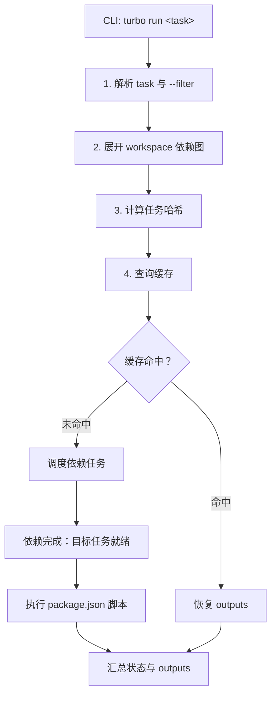

对应本仓库的 `turbo.json`：

- `build` 通过 `^build` 先调度 workspace 依赖的构建。
- `dev` 通过 `^dev` 先完成依赖包的 `dev`。
- `typecheck` 通过 `^typecheck` 先调度依赖包的类型检查。
- `test` 依赖当前包的 `build`，避免测试使用过期产物。
- `check` 依赖当前包的 `build` 与依赖包的 `typecheck`（`^typecheck`）；各包的 `check` 脚本本身已经是 `typecheck && test`，因此不再把 `typecheck`、`test` 同时写进 `dependsOn`，否则同一件事会被调度两次。
- `lint` 是仓库级根任务（`//#lint`）：ESLint 只使用根 `eslint.config.ts`，没有包定义 `lint` 脚本，写成普通任务只会匹配到空集。
- `build` 声明 `env: ["NODE_ENV"]`：客户端 bundle 在 tsdown 里用 `process.env.NODE_ENV` 做 `define`，不声明会让不同 `NODE_ENV` 共用同一份缓存。
- `docs` 包的 `build` 用包级 `turbo.json` 覆盖 `outputs` 为 `.vitepress/dist/**`：VitePress 的实际产物不在 `dist/`，必须显式声明才能参与缓存。
- `docs` 包的 `dev` 声明 `interactive: true`：TUI 的「interact with task」把 stdin 交给该任务，VitePress 快捷键才生效；`interactive` 与 `cache: true` 互斥，且没有 TUI 时 Turbo 直接报错而不降级，因此 `start` 必须按 TTY 决定是否把它放进 `turbo watch`。
- 全局 `ui` 设置为 `tui`；多任务并行时使用终端任务面板分别查看日志，避免不同任务的输出混合在同一条流中。
- 交互命令会先完成所有主选项和子选项询问，再统一启动已选任务，避免任务执行期间继续等待输入。

## 各 Turbo 任务步骤

### `build`

交互模式先选择构建目标，FPK 和文档可以多选；参数模式则直接进入对应分支：

```bash
pnpm run build
pnpm run build -- --fpk --app fn-memos
pnpm run build -- --docs
```

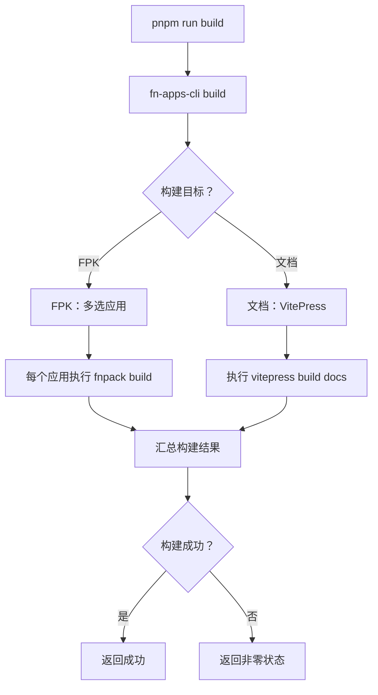

### `start`

`start` 是用户可见的开发启动入口。当前只有一个目标：VitePress 文档站，交给一次 `turbo watch` 运行，终端保留 Turbo 的 TUI。

文档服务的 `dev` 在 `docs/turbo.json` 中标记 `interactive: true`，让 TUI 能把键盘交给它（TUI 中按 `i` 交互、`Ctrl+z` 返回），VitePress 的 `h`/`r` 快捷键因此可用。Turbo 拒绝在没有终端界面时运行 interactive 任务，所以 `start` 按 TTY 选择文档服务的运行位置：有 TTY 时进入 `turbo watch`，没有时（CI、管道、后台任务）直接启动 `vitepress dev`，避免整条命令因 `Cannot run interactive task` 失败。

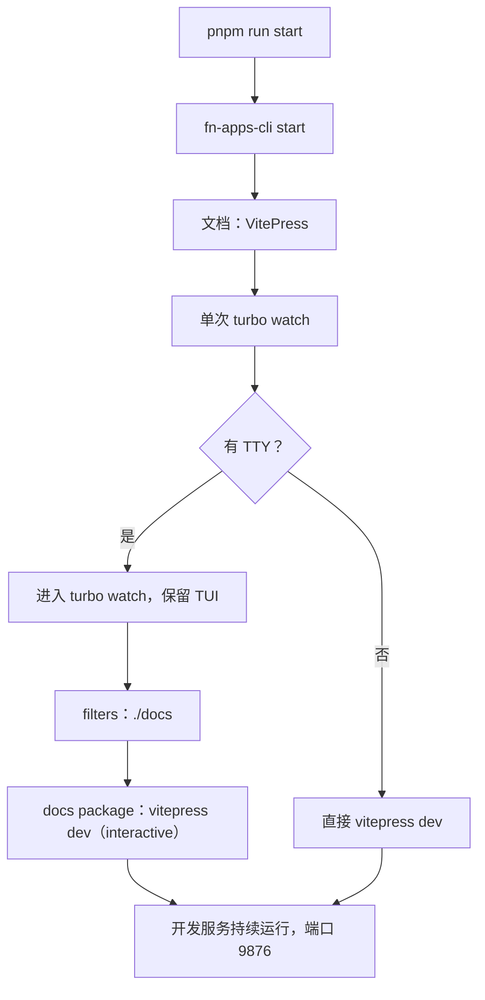

### `typecheck`

`typecheck` 由根脚本直接调用 Turbo，不经过 `fn-apps-cli` 交互层。

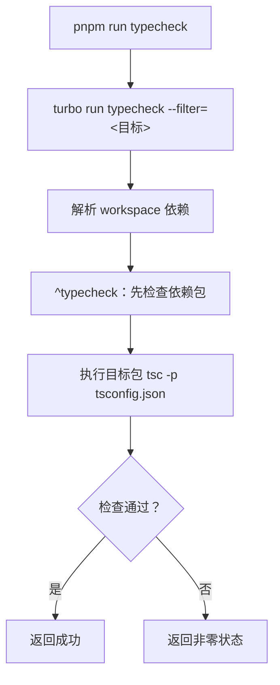

### `test`

`test` 由根脚本直接调用 Turbo，先满足当前包的 `build` 依赖，再启动 Vitest。

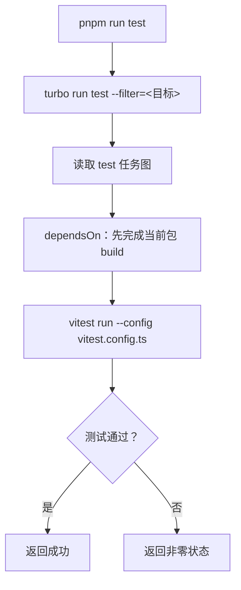

### `test`

`test` 同样由根脚本直接调用 Turbo，并先等待 `test` 完成。

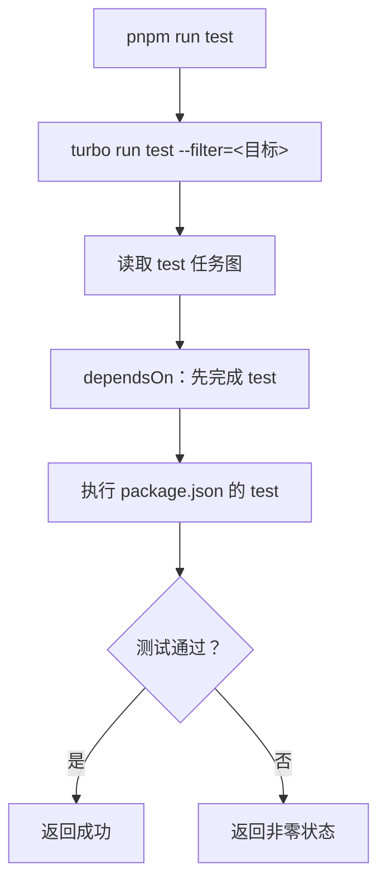

### `check`

`check` 与 `build` 一样由 `fn-apps-cli` 先处理多选目标，再并行执行直接检查和 Turbo 检查。

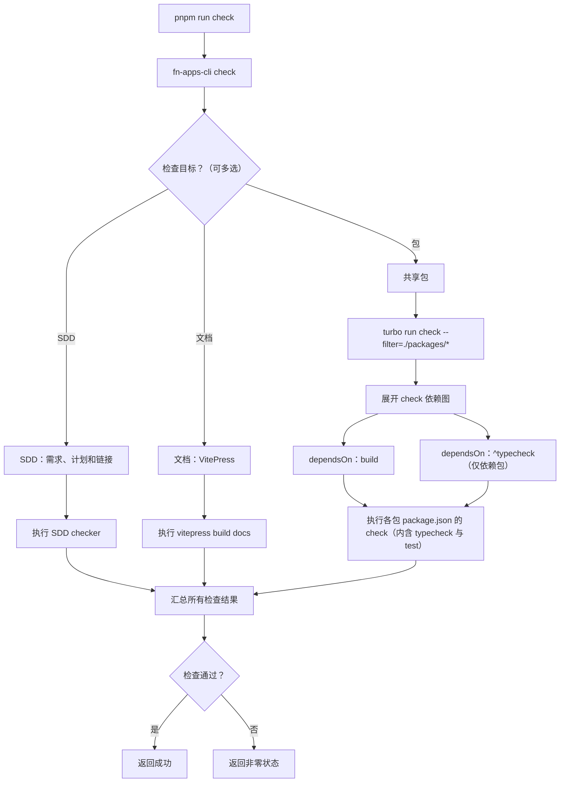

## 其他 CLI 命令步骤

非 Turbo 任务也沿用相同的表达方式：根命令进入 `fn-apps-cli`，命令模块负责交互和参数分支，最后执行实际工具并汇总状态。

### `version`

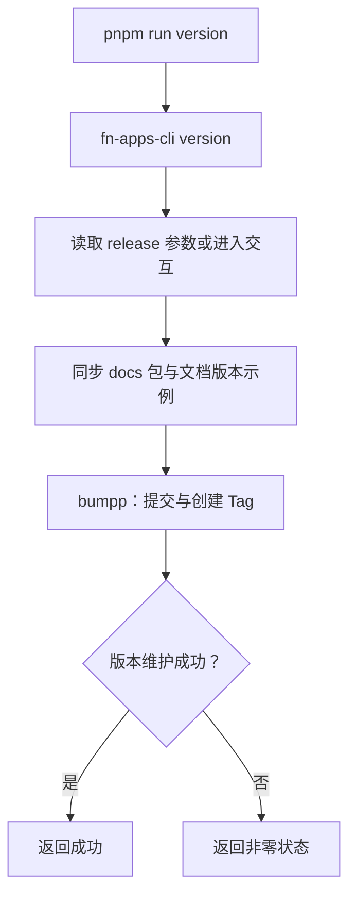

### `release:notes`

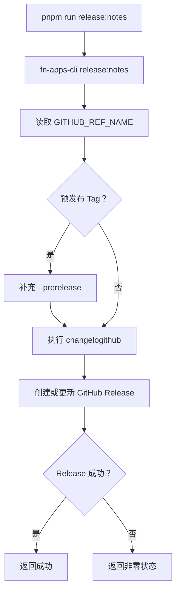

## 检查任务交互

执行 `pnpm run check` 会进入多选提示；Agent、CI 或提交脚本应使用参数避免交互：

```bash
pnpm run check -- --sdd
pnpm run check -- --docs
pnpm run check -- --all
```

下图展示一次 `--all` 检查的主要交互。SDD 和文档检查由 CLI 直接处理，包检查统一交给一次 Turbo 调度；Turbo 根据依赖图先构建共享包，再执行各包的 `check`。

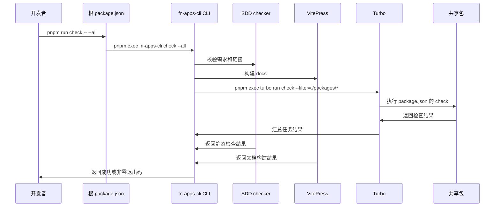

## 构建任务交互

FPK 构建直接调用 fnpack，不需要 Turbo：

```bash
pnpm run build -- --fpk --app fn-memos
```

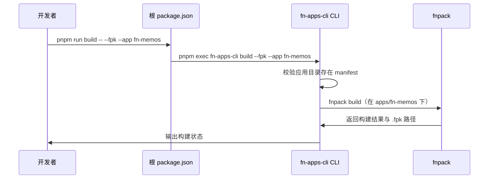

文档构建走 VitePress，由 CLI 直接调用：

```bash
pnpm run build -- --docs
```

## 开发启动任务

```bash
# 交互选择
pnpm run start

# Agent 或脚本直接指定
pnpm run start -- --docs
```

有 TTY 时文档服务交给 `turbo watch dev`，终端保留 Turbo 的 TUI，VitePress 的 `h`/`r` 快捷键可用；没有 TTY 时直接启动 `vitepress dev`，避免 interactive 任务报错。

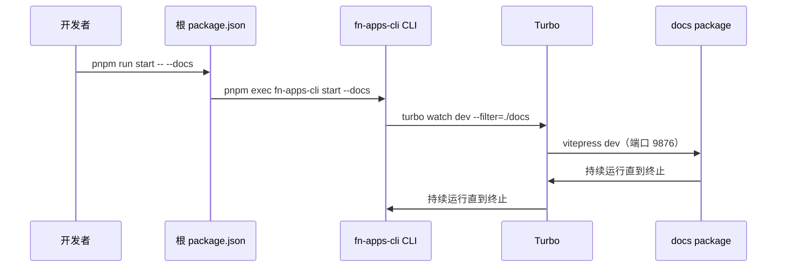

## 编写和修改规则

1. 根 `package.json` 只增加稳定入口，不把 `cd`、重复构建依赖或包内实现写入根脚本。
2. 包的实际任务放在对应 workspace 的 `package.json`；任务名称要能被 Turbo 统一调用。
3. 新增任务后同步在 `turbo.json` 声明 `dependsOn`、`outputs`、`cache` 或 `persistent`。
4. workspace 依赖必须真实写入包的 `dependencies` 或 `devDependencies`，否则 `^build`、`^dev` 无法推导依赖顺序。
5. 共享包作为依赖参与 `dev` 时必须是一次性任务：`persistent: false` 且在包内 `turbo.json` 覆盖，否则 `^dev` 会因「persistent task cannot be depended on」报错。
6. `package.json` 和 Workflow 中使用 `turbo run`；持续开发使用 `turbo watch`。
7. 同一类检查尽量通过一次 Turbo 调度传入多个 filter，避免共享依赖被多个 Turbo 进程重复执行。

## 常用验证

```bash
pnpm run check -- --sdd --docs
pnpm run check -- --all
pnpm run build -- --docs
```

相关页面：

- [开发环境与脚本](./environment-and-scripts)
- [Manifest 配置](./manifest)
- [生命周期脚本](./lifecycle)
- [权限与入口](./permissions)
- [用户向导](./wizard)
- [仓库结构](./repository-structure)
